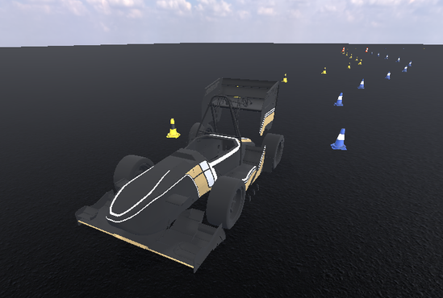

# Mirena Workspace · MirenaSim

Workspace de **ROS 2 Jazzy** para Formula Student Driverless: simulador en
**Godot 4**, circuitos de conos, LiDAR y cámaras en GPU, IMU, GNSS y velocidades
de rueda, con mensajes compartidos y visualizadores de RViz 2.



| Documentación | Contenido |
|---|---|
| [Instalación](https://robesafe-uah.github.io/mirena_ws/) | Preparar Linux, Docker, NVIDIA y la pantalla. |
| [Ejecución](https://robesafe-uah.github.io/mirena_ws/ejecucion/) | Iniciar el contenedor, lanzar el simulador y abrir RViz. |
| [Simulador](https://robesafe-uah.github.io/mirena_ws/simulador/) | Controles, modos de conducción y circuitos. |
| [Vehículo](https://robesafe-uah.github.io/mirena_ws/vehiculo/) | Modelo físico, configuración y montaje de sensores. |
| [ROS2](https://robesafe-uah.github.io/mirena_ws/topics/) | Topics, mensajes, control, TF y ejemplos. |
| [Sensores](https://robesafe-uah.github.io/mirena_ws/sensores/) | Modelos de LiDAR, cámara, IMU y GNSS; parámetros y QoS. |
| [Repositorio](https://robesafe-uah.github.io/mirena_ws/repositorio/) | Paquetes, desarrollo y publicación de la documentación. |

## Inicio rápido

Requiere Linux, Docker Engine, Make, GPU NVIDIA con NVIDIA Container Toolkit y
una sesión X11/XWayland. Desde la raíz del repositorio, en el equipo:

```bash
make build
make run
```

Dentro del contenedor:

```bash
ros2 run mirena_sim mirena_sim --display-driver x11 --ros-args -p track:=random
```

El repositorio se comparte en `/ros2_ws`. Para abrir otra terminal del contenedor,
ejecutar `make attach` desde el equipo. El dominio ROS 2 por defecto es `42`.

## Documentación local

Las [páginas fuente](docs/pages) utilizan MkDocs Material, como `sci_practica_final`.
Con Python 3 y su módulo `venv` instalados, ejecutar desde la raíz:

```bash
python3 -m venv docs/.venv
docs/.venv/bin/python -m pip install -r docs/requirements.txt
make docs
```

Abrir <http://127.0.0.1:8000>. `make docs-build` valida los enlaces y genera
`docs/site/` en modo estricto.

Para publicar, seleccionar **Settings → Pages → Build and deployment → Source →
GitHub Actions** en el repositorio. El [workflow de documentación](.github/workflows/docs.yml)
comprueba los cambios en las pull requests y publica al actualizar `main`.

[Licencia MIT](LICENSE)
