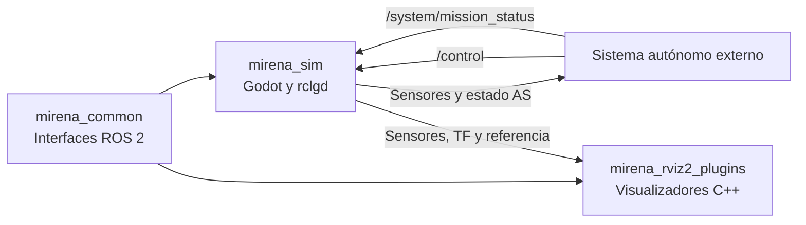

# Repositorio

`mirena_ws` reúne el simulador, los mensajes que comparte con el sistema autónomo y sus visualizadores de RViz. La simulación vive en un proyecto Godot; `rclgd` conecta los scripts GDScript con ROS 2 y permite construir y ejecutar el proyecto desde el workspace.

En esta pestaña, las subpáginas [Simulador](simulador.md) y [Vehículo](vehiculo.md)
explican el uso de Godot, la dinámica y la configuración del coche. Las
interfaces y los modelos de [Sensores](sensores.md) se agrupan en la pestaña
[ROS2](topics.md).

## Archivos principales

| Archivo o carpeta | Uso |
| --- | --- |
| `docker/` | Imagen Docker, arranque del entorno y comprobaciones de bienvenida. |
| `src/` | Paquetes ROS 2, proyecto Godot, mensajes y visualizadores de RViz. |
| `docs/` | Páginas de esta guía, configuración de MkDocs y dependencias. |
| `Makefile` | Construcción, arranque, acceso y cierre del contenedor. |
| `README.md` | Acceso a la documentación publicada. |
| `LICENSE` | Licencia del proyecto. |

## Organización

```text
mirena_ws/
├── .github/workflows/       # Automatización de GitHub Pages
├── docker/                 # Imagen y arranque del entorno ROS 2 Jazzy
├── docs/
│   ├── pages/              # Páginas Markdown e imágenes de esta documentación
│   ├── mkdocs.yml          # Navegación y configuración del sitio
│   └── requirements.txt    # Dependencias del sitio
├── src/
│   ├── mirena_common/
│   │   ├── msg/            # Contratos de mensajes
│   │   ├── CMakeLists.txt
│   │   └── package.xml
│   ├── mirena_rviz2_plugins/
│   │   ├── src/displays/    # Implementaciones C++
│   │   ├── icons/classes/  # Iconos de los displays
│   │   └── rviz_common_plugins.xml
│   └── mirena_sim/
│       ├── addons/         # rclgd y sensores ROS
│       ├── Assets/         # Modelos, materiales y texturas
│       ├── Scenes/         # Escenas y scripts Godot
│       ├── TrackFiles/     # Circuitos JSON incluidos
│       ├── mirena_sim.rviz # Configuración de visualización
│       ├── package.xml
│       └── project.godot
├── Makefile
└── README.md
```

`build/`, `install/` y `log/` son salidas de `colcon`. La documentación HTML se genera en `docs/site/`. El código fuente que hay que mantener está en `src/` y `docs/pages/`.

## Arquitectura



| Paquete | Construcción | Responsabilidad |
| --- | --- | --- |
| `mirena_common` | `ament_cmake` y `rosidl` | Genera los mensajes de estado, control, entidades, circuitos y misión. |
| `mirena_sim` | Tipo de construcción `rclgd` | Proyecto Godot, dinámica del vehículo, circuito, sensores e interfaz gráfica. |
| `mirena_rviz2_plugins` | `ament_cmake`, C++ y Qt 5 | Añade displays para `Car`, `EntityList` y `Track` a RViz 2. |

Los nodos de percepción, estimación, planificación y control de un sistema autónomo se conectan a estas interfaces desde otros paquetes. Consulta [Interfaces ROS 2](topics.md) para conocer topics, frames y unidades.

## Escenas y scripts del simulador

| Archivo, relativo a `src/mirena_sim/` | Función |
| --- | --- |
| `project.godot` | Define la escena de arranque, plugins, acciones de entrada, física a 400 Hz y parámetros ROS del proyecto. |
| `Scenes/Sim/Sim.tscn` | Compone pista, coche, interfaz, cámara libre y entorno visual. |
| `Scenes/Sim/sim_env.gd` | Asigna las referencias del coche y la pista al singleton `Sim` antes de inicializar los hijos. |
| `Scenes/Sim/sim.gd` | Singleton que conserva esas referencias, recoge argumentos y registra las cámaras entre las que se puede alternar. |
| `Scenes/Sim/UI/SimUI.tscn` | Ventana de configuración y controles del simulador. |
| `Scenes/Sim/UI/vehicle_menu.gd` | Selección del piloto, estado AS, misión y reinicio del vehículo. |
| `Scenes/Vehicle/mirena_car.tscn` | Cuerpo físico, ruedas, modelo, cámaras y montaje de sensores. |
| `Scenes/Vehicle/vehicleMotion.gd` | Dinámica, modos de conducción, suscripciones, velocidades de rueda y referencia del vehículo. |
| `Scenes/Track/Track.tscn` y `track.gd` | Carga, genera y exporta circuitos; publica el mapa completo y las puertas. |
| `Scenes/Track/track_generator.gd` | Generador de trazados Trackdrive. |
| `Scenes/Track/Gate/` y `Scenes/Track/Cone/` | Puertas, tipos de cono y sus escenas físicas. |
| `Scenes/FreeCam/freecam.gd` | Movimiento de la cámara libre. |

`Scenes/Sim/sim_debug.gd` y `publish_task.gd` contienen una implementación adicional de tareas de publicación. La escena principal no incorpora `sim_debug.gd`; los topics activos del vehículo se crean en `vehicleMotion.gd`.

## Sensores y enlace con ROS 2

`addons/rclgd/ros_init.gd` inicializa el contexto ROS al ejecutar el proyecto, incorpora los parámetros de `project.godot` y lo cierra al salir. El addon `rclgd` proporciona nodos, mensajes, publicadores, suscriptores, temporizadores y TF mediante una GDExtension.

El plugin de editor `addons/rclgd/rclgd.gd` consulta las dependencias de `package.xml` y genera las clases tipadas de mensajes en `addons/rclgd/gen/`. Por ejemplo, `mirena_common/msg/CarControl` se utiliza desde GDScript como `RosMirenaCommonCarControl`.

| Ruta en `addons/rclgd-sensors/` | Contenido |
| --- | --- |
| `ros_sensor.gd` | Base común: nodo ROS, TF de montaje, frecuencia de muestreo y QoS de sensores. |
| `publish_queue.gd` | Cola que publica desde un hilo y se detiene al eliminar el sensor. |
| `ros_camera/` | Cámara pinhole y profundidad opcional mediante un shader de cómputo. |
| `ros_fisheye_camera/` | Cámara de gran angular con proyección fisheye o equirectangular; disponible como tipo de nodo. |
| `ros_lidar/` | LiDAR renderizado con seis vistas y ensamblado de la nube `PointCloud2` en GPU. |
| `ros_imu/` | IMU con aceleración propia, velocidad angular, orientación, ruido y deriva. |
| `ros_gps/` | GNSS con origen geográfico y error de posición correlacionado. |
| `plugin.gd` y `*_gizmo.gd` | Registro de sensores y ayudas visuales en el editor. |

La cámara pinhole, el LiDAR, la IMU y el GNSS ya están montados en `mirena_car.tscn`. La cámara fisheye está disponible en el addon para incorporarla a una escena. Los parámetros de cada modelo se describen en [Sensores](sensores.md).

## Flujo de desarrollo

### Construir el workspace

El [entorno de instalación](index.md) explica los requisitos y el uso de Docker. Desde la raíz del workspace, con ROS 2 y `rclgd` disponibles:

```bash
source /opt/ros/jazzy/setup.bash
colcon build --symlink-install --base-paths "$PWD/src"
source install/local_setup.bash
```

Los paths absolutos de `--base-paths` permiten que `rclgd` cree enlaces de instalación válidos. Si utilizas el contenedor, el repositorio está montado en `/ros2_ws` y el entrypoint aplica ese mismo comando cuando `AUTO_BUILD=1`.

Para reconstruir un paquete y sus dependencias del workspace:

```bash
colcon build --symlink-install --base-paths "$PWD/src" \
  --packages-up-to mirena_sim
source install/local_setup.bash
```

### Abrir Godot

Ejecuta el editor desde una terminal con el entorno ROS y el overlay cargados:

```bash
ros2 run rclgd godot --display-driver x11 --editor --path src/mirena_sim
```

Abre `Scenes/Sim/Sim.tscn` para trabajar con el entorno completo, o `Scenes/Vehicle/mirena_car.tscn` para cambiar el vehículo y sus sensores. El proyecto utiliza el renderer Forward Plus y recursos de GPU; el editor distribuido con `rclgd` debe ser compatible con las características declaradas en `project.godot`.

Después de cambiar mensajes en `mirena_common/msg`, reconstruye las interfaces y carga de nuevo `install/local_setup.bash` antes de abrir el editor. El menú **Project → Tools → Regenerate ROS2 Types** fuerza la regeneración de las clases GDScript de mensajes. Los cambios de campos de un mensaje requieren actualizar también los scripts y displays que los usan.

### Añadir o modificar un sensor

1. Abre `mirena_car.tscn` y selecciona o añade un nodo del addon `rclgd-sensors`.
2. Ajusta el montaje y configura `frame_id` y `parent_frame_id`; los sensores del coche usan `car/cog` como padre.
3. Ajusta resolución, ruido o frecuencia en el inspector. El nombre del nodo y `ros_namespace` determinan los topics privados.
4. Ejecuta la escena y comprueba el topic y TF con los comandos de [Interfaces ROS 2](topics.md).

Para crear un modelo nuevo, hereda de `RosSensor`, configura publicadores en `_sensor_ready()` y usa `_start_sampling(rate)` para recibir llamadas periódicas a `_sample()`. `_advertise()` configura el QoS de sensores y `_create_publish_queue()` permite trasladar la publicación a otro hilo cuando el volumen de datos lo necesita.

## Visualizadores RViz

El paquete registra tres clases en `rviz_common_plugins.xml`:

| Display en RViz | Tipo | Implementación |
| --- | --- | --- |
| `mirena/CarDisplay` | `mirena_common/msg/Car` | `car_display.cpp` y `car_display.hpp`: pose, velocidad, trayectoria y covarianza opcional. |
| `mirena/EntityList` | `mirena_common/msg/EntityList` | `entity_list.cpp` y `entity_list.h`: representación de los conos según su tipo. |
| `mirena/Track` | `mirena_common/msg/Track` | `track.cpp`: representación del trazado a partir de sus puertas. |

`src/mirena_sim/mirena_sim.rviz` reúne estos displays con imagen, nube de puntos y TF; el frame fijo inicial es `debug_map`. Los sensores ya están configurados con fiabilidad **Best Effort** en ese archivo.

Para añadir un display, coloca sus fuentes y cabeceras en `src/mirena_rviz2_plugins/src/displays/`, exporta la clase con `PLUGINLIB_EXPORT_CLASS` y regístrala en `rviz_common_plugins.xml`. El `CMakeLists.txt` recoge los archivos `.cpp`, `.hpp` y `.h` de ese directorio; añade dependencias al CMake y al manifiesto si la implementación las necesita. Reconstruye el paquete y carga el overlay antes de abrir RViz.

## Herramientas del entorno

| Archivo | Función |
| --- | --- |
| `docker/Dockerfile` | Ubuntu 24.04, ROS 2 Jazzy Desktop, `ros-jazzy-rclgd`, utilidades de desarrollo y librerías de gráficos. |
| `docker/entrypoint.sh` | Ajusta UID/GID del usuario del contenedor, carga ROS, construye el workspace si se solicita y carga su overlay. |
| `docker/welcome.sh` | Muestra el estado de arranque y los comandos disponibles. |
| `Makefile` | Construcción y ciclo de vida del contenedor, limpieza de salidas y comandos de documentación. |

Ejecuta `make help` para consultar los objetivos. La configuración predeterminada usa `ROS_DOMAIN_ID=42`, red e IPC del host, acceso X11 y GPU NVIDIA. Las instrucciones de uso y variables están en [Ejecución](ejecucion.md).

## Mantener la documentación

Las páginas se escriben en Markdown bajo `docs/pages/` y se organizan desde `docs/mkdocs.yml`. Las imágenes están en `docs/pages/assets/images/`. El sitio se genera con MkDocs Material y se publica con GitHub Pages.

Prepara las herramientas una vez desde la raíz del repositorio:

```bash
python3 -m venv docs/.venv
docs/.venv/bin/python -m pip install -r docs/requirements.txt
```

Mientras editas:

```bash
make docs
```

Abre la dirección que indique MkDocs en la terminal. Para comprobar los enlaces y generar el HTML con la misma validación estricta prevista para CI:

```bash
make docs-build
```

Al añadir una página, incorpórala a `nav` en `docs/mkdocs.yml` y enlázala con rutas relativas a otros Markdown. Actualiza también el `README.md` cuando cambien el arranque rápido, los requisitos o la URL pública.

El [workflow de documentación](https://github.com/RobeSafe-UAH/mirena_ws/blob/main/.github/workflows/docs.yml) comprueba las pull requests y publica los cambios de documentación al actualizar `main`. También se puede lanzar manualmente con **Actions → Documentación → Run workflow**, seleccionando `main`.

En **Settings → Pages → Build and deployment → Source** debe estar seleccionado **GitHub Actions**, según la [guía oficial de GitHub Pages](https://docs.github.com/en/pages/getting-started-with-github-pages/using-custom-workflows-with-github-pages). La opción **Deploy from a branch** activa otra publicación con Jekyll: transforma el README en la portada y puede sobrescribir el sitio de MkDocs, dejando sus enlaces sin las páginas correspondientes. El workflow comprueba este ajuste antes de publicar y muestra un error si el origen es incorrecto.

Después de publicar, el workflow comprueba que la versión visible corresponde al commit que acaba de desplegar, que la portada pertenece a MkDocs y que todas las páginas del sitemap responden correctamente. La revisión publicada se registra en `deployment.json`. Si es necesario recuperar el sitio tras corregir el origen, ejecutar **Actions → Documentación → Run workflow** sobre `main`.

La dirección configurada es <https://robesafe-uah.github.io/mirena_ws/>. Los permisos de publicación se limitan al trabajo de despliegue; las pull requests solo construyen el sitio.

El HTML generado es una salida de compilación; las revisiones se hacen sobre los Markdown, los recursos y la configuración. `docs/site/` y el entorno virtual quedan excluidos de Git.
