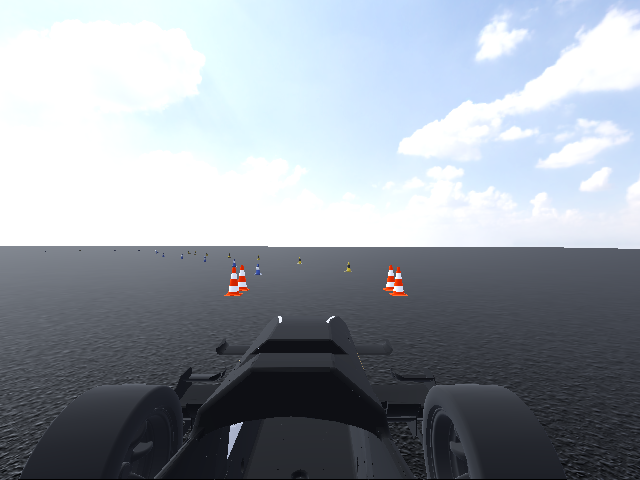
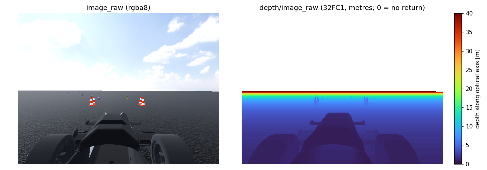
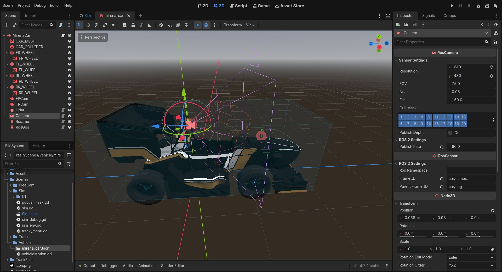

# Cámara

`RosCamera` es una cámara pinhole ideal. Renderiza la escena mediante una `Camera3D` en un `SubViewport`, lee la imagen de forma asíncrona y publica color e intrínsecos. Opcionalmente genera una imagen de profundidad alineada con el color a partir del mismo renderizado.



La imagen del repositorio corresponde a `/camera/image_raw`, con resolución 640 × 480.

## Salida ROS 2

| Topic de Mirena | Tipo | Contenido |
| --- | --- | --- |
| `/camera/image_raw` | `sensor_msgs/msg/Image` | `rgba8`, con `step = 4 × width` |
| `/camera/camera_info` | `sensor_msgs/msg/CameraInfo` | Intrínsecos y modelo `plumb_bob` sin distorsión |
| `/camera/depth/image_raw` | `sensor_msgs/msg/Image` | `32FC1`: profundidad en metros, `0` sin retorno |
| `/camera/depth/camera_info` | `sensor_msgs/msg/CameraInfo` | Intrínsecos de la imagen de profundidad |

Los dos topics de profundidad solo existen si `publish_depth` está activado al inicializar el sensor. **Mirena lo tiene desactivado**. En el complemento, los nombres son privados: `~/image_raw`, `~/camera_info`, `~/depth/image_raw` y `~/depth/camera_info`.

Las imágenes se publican en `car/camera_optical`, con **z hacia delante, x hacia la derecha e y hacia abajo**. El sensor publica dos transformaciones estáticas:

```text
car/cog → car/camera → car/camera_optical
```

`car/camera` sirve para expresar el montaje físico; `car/camera_optical` es el frame que debes utilizar al proyectar puntos en píxeles.

## Modelo pinhole

Los píxeles son cuadrados y el punto principal está en el centro. `fov` es el campo de visión **vertical**. Para una imagen de ancho $w$ y alto $h$:

$$
f_y=\frac{h}{2\tan(\mathrm{fov}/2)},\qquad
f_x=f_y,\qquad c_x=\frac{w}{2},\qquad c_y=\frac{h}{2}.
$$

$$
K=\begin{bmatrix}f_x&0&c_x\\0&f_y&c_y\\0&0&1\end{bmatrix},\qquad
D=[0,0,0,0,0],
$$

$$
P=\begin{bmatrix}f_x&0&c_x&0\\0&f_y&c_y&0\\0&0&1&0\end{bmatrix}.
$$

Con 640 × 480 y 75°, $f_x=f_y\approx312.8$ píxeles y el FOV horizontal es aproximadamente 91.3°. Para elegir el FOV a partir de una calibración, usa $\mathrm{fov}=2\arctan(h/(2f_y))$ y convierte el resultado a grados para el Inspector.

La implementación no añade distorsión de lente, rolling shutter, desenfoque de movimiento ni ruido del sensor. Aunque el topic se llame `image_raw`, el modelo geométrico equivale al de una imagen rectificada.

## Profundidad opcional



`DepthCapture.glsl` linealiza la profundidad del renderizado mediante la inversa de la matriz de proyección y escribe una textura `R32F`. Cada valor es la distancia $Z$ a lo largo del eje óptico, **no la distancia euclídea al centro de la cámara**. El valor `0` indica ausencia de retorno, como el cielo o una superficie fuera del plano lejano.

Color y profundidad comparten captura, resolución, frame, marca de tiempo e intrínsecos. El punto 3D correspondiente al píxel $(u,v)$ es:

$$
X=\frac{(u-c_x)Z}{f_x},\qquad
Y=\frac{(v-c_y)Z}{f_y},\qquad
Z=\mathrm{depth}(u,v).
$$

La profundidad no incorpora ruido de un sensor estéreo o ToF. Si necesitas ese comportamiento, añade un modelo específico en el procesamiento posterior. Los flujos de color y profundidad se publican desde colas independientes; empareja las imágenes por `header.stamp`.

## Configuración



| Propiedad | Complemento | Mirena | Significado |
| --- | --- | --- | --- |
| `resolution` | 640 × 480 | 640 × 480 | Tamaño de imagen |
| `fov` | 75° | 75° | Campo de visión vertical |
| `near` / `far` | 0.05 / 150 m | 0.05 / 150 m | Planos de recorte |
| `cull_mask` | Todas las capas | Todas las capas | Mallas visibles |
| `publish_depth` | `false` | `false` | Publicación de profundidad |
| `publish_rate` | 15 Hz | 60 Hz | Tasa de captura solicitada |

Estas propiedades se leen al crear la cámara y sus mensajes. Configúralas en la escena antes de ejecutar. Los campos comunes de namespace y TF se describen en [Sensores](../sensores.md).

## Consumo y rendimiento

Cada captura vuelve a renderizar la escena. La carga crece con la resolución y la frecuencia; además, el sensor no puede capturar más de una vez por fotograma. El viewport desactiva el atlas de sombras posicionales, el antialiasing de pantalla, el debanding y HDR 2D. La copia a los mensajes y su publicación se realizan en un hilo de la cola de salida.

Muchos consumidores esperan `rgb8` o `bgr8`. Con `cv_bridge`, puedes convertir la codificación publicada:

```python
image_bgr = bridge.imgmsg_to_cv2(msg, desired_encoding="bgr8")
```

Si procesas los bytes directamente, recuerda que hay cuatro canales por píxel:

```python
image_rgba = np.frombuffer(msg.data, dtype=np.uint8).reshape(msg.height, msg.width, 4)
image_rgb = image_rgba[:, :, :3]
```

Configura las suscripciones como `best_effort`. En RViz, selecciona el topic de imagen y su `CameraInfo`, y utiliza `car/camera_optical` para la geometría de proyección.
