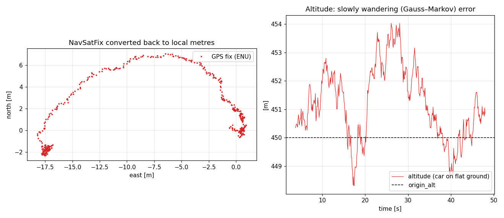
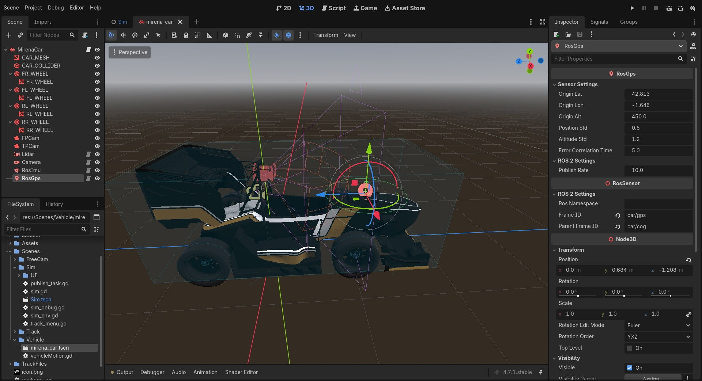

# GNSS

`RosGps` publica la posición de su antena como `sensor_msgs/msg/NavSatFix`. Ancla el origen del mundo de Godot a una latitud, longitud y altitud, convierte la posición con una aproximación geodésica local WGS-84 y añade un error de posición correlacionado en el tiempo.

La gráfica del repositorio ilustra el error que deriva lentamente sobre una trayectoria y la dispersión de altitud. Los grupos de medidas en los extremos corresponden al coche detenido.

## Salida ROS 2

| Campo | Valor |
| --- | --- |
| Topic del complemento | `~/fix` |
| Topic de Mirena | `/ros_gps/fix` |
| Tipo | `sensor_msgs/msg/NavSatFix` |
| Frame de Mirena | `car/gps` |
| Estado | `STATUS_FIX = 0` |
| Servicio | `SERVICE_GPS = 1` |
| Covarianza | Diagonal $[\sigma_h^2,\sigma_h^2,\sigma_v^2]$ |
| Tipo de covarianza | `COVARIANCE_TYPE_DIAGONAL_KNOWN = 2` |

El mensaje siempre declara una solución válida. La calidad de servicio es `best_effort`, como se describe en [Sensores](../sensores.md).

## Referencia geográfica

La posición global de Godot se convierte a ejes ROS y se interpreta como **ENU**: x este, y norte y z arriba. Estos ejes corresponden al mundo del simulador, no a la orientación de salida del circuito. El origen geográfico se configura con `origin_lat`, `origin_lon` y `origin_alt`.

$$
p_{\mathrm{ENU}}=\mathrm{to\_ros}(p_{\mathrm{Godot}})+e.
$$

Para comparar la medida con el ground truth, utiliza la posición de la **antena** en `debug_map`. La transformación estática `car/cog → car/gps` contiene el brazo de palanca respecto al coche.

### Conversión WGS-84

El código usa el semieje mayor $a=6378137$ m, el achatamiento $f=1/298.257223563$ y $e^2=f(2-f)$. Para la latitud de origen $\varphi_0$, los radios de curvatura meridiano y del primer vertical son:

$$
M=\frac{a(1-e^2)}{(1-e^2\sin^2\varphi_0)^{3/2}},\qquad
N=\frac{a}{\sqrt{1-e^2\sin^2\varphi_0}}.
$$

Con el origen expresado en grados y las coordenadas ENU en metros, la medida es:

$$
\mathrm{lat}=\mathrm{lat}_0+\frac{p_{\mathrm{ENU},y}}{M}\frac{180}{\pi},
$$

$$
\mathrm{lon}=\mathrm{lon}_0+\frac{p_{\mathrm{ENU},x}}{N\cos\varphi_0}\frac{180}{\pi},\qquad
\mathrm{alt}=\mathrm{alt}_0+p_{\mathrm{ENU},z}.
$$

Es una aproximación plana local alrededor del origen, adecuada para representar un circuito próximo a ese punto. No realiza una conversión global ENU–ECEF ni modela un geoide. Si necesitas contrastar posiciones, aplica la misma aproximación al convertir las medidas de vuelta a metros.

## Error correlacionado

En cada medida, con $\Delta t=1/\mathrm{publish\_rate}$, el error sigue un proceso de Gauss–Markov de primer orden:

$$
e_k=\rho e_{k-1}+\sqrt{1-\rho^2}\,w_k,\qquad
\rho=e^{-\Delta t/T_c},
$$

$$
w_k\sim\mathcal N\left(0,\operatorname{diag}(\sigma_h^2,\sigma_h^2,\sigma_v^2)\right).
$$

`position_std` es $\sigma_h$ por eje horizontal, `altitude_std` es $\sigma_v$ y `error_correlation_time` es $T_c$. La primera medida extrae el error de la distribución estacionaria. El factor $\sqrt{1-\rho^2}$ mantiene las desviaciones típicas configuradas al variar la tasa o el tiempo de correlación.

Con `error_correlation_time = 0`, las perturbaciones son independientes entre medidas. Con un valor positivo, el error deriva lentamente. Un filtro que suponga ruido GNSS blanco puede dar demasiado peso a varias medidas consecutivas con el mismo sesgo; compara ambos casos al ajustar tu estimador.

## Configuración

Mirena utiliza los valores iniciales del complemento:

| Propiedad | Valor | Significado |
| --- | --- | --- |
| `origin_lat` | 42.8125° | Latitud del origen de Godot |
| `origin_lon` | −1.6458° | Longitud del origen de Godot |
| `origin_alt` | 450 m | Altitud asignada al origen |
| `position_std` | 0.5 m | Desviación típica horizontal por eje |
| `altitude_std` | 1.2 m | Desviación típica vertical |
| `error_correlation_time` | 5 s | Tiempo de correlación; `0` da ruido independiente |
| `publish_rate` | 10 Hz | Tasa solicitada de medidas |

El origen se comparte conceptualmente entre los receptores que deban describir el mismo mundo; configura los mismos valores si añades más sensores GNSS. Ajustar las desviaciones cambia la dispersión y la covarianza publicada, pero no activa modelos de receptor ni cambia el estado de la solución.

## Límites del modelo

- No se simulan pérdida de cobertura, satélites, geometría de constelación, multitrayectoria ni cambios de tipo de solución.
- El receptor declara siempre `STATUS_FIX` y `SERVICE_GPS`, aunque reduzcas el error hasta valores propios de una solución RTK.
- La altitud suma el desplazamiento vertical al valor de origen; no incluye corrección de geoide.
- El error usa el periodo nominal `1 / publish_rate` al actualizarse. No estima el tiempo transcurrido entre callbacks si la ejecución se retrasa.
