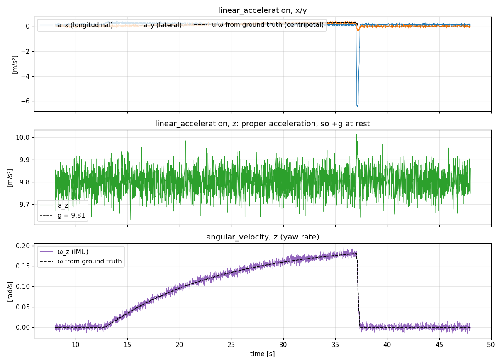
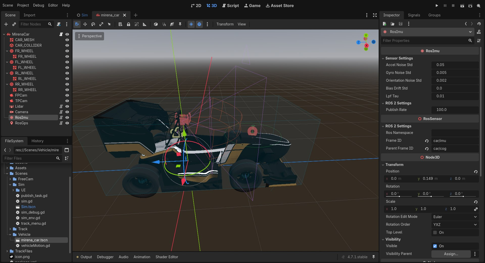

# IMU

`RosImu` mide el movimiento del ancestro `RigidBody3D` más próximo, en la posición exacta de su montaje. Publica aceleración propia, velocidad angular y orientación, con ruido blanco y sesgos que derivan con el tiempo.

La gráfica existente en el repositorio ilustra un giro seguido de una frenada. La aceleración vertical se sitúa cerca de $+g$: un acelerómetro en reposo mide aceleración propia, incluida la reacción que sostiene al vehículo frente a la gravedad.

## Salida ROS 2

| Campo | Valor |
| --- | --- |
| Topic del complemento | `~/data` |
| Topic de Mirena | `/ros_imu/data` |
| Tipo | `sensor_msgs/msg/Imu` |
| Frame de Mirena | `car/imu` |
| Ejes | x hacia delante, y hacia la izquierda, z hacia arriba |
| Aceleración | `linear_acceleration`, en m/s² |
| Velocidad angular | `angular_velocity`, en rad/s |
| Orientación | Cuaternión de actitud del sensor en el mundo |
| Incertidumbre | Matrices de covarianza diagonales |

Se aplican el QoS y las transformaciones estáticas comunes descritos en [Sensores](../sensores.md).

## Muestreo y aceleración

La IMU se actualiza en `_physics_process`, una vez por paso de física. `project.godot` configura **400 Hz**. Publica en el paso más próximo a cada periodo de `publish_rate`; en Mirena, la tasa solicitada es **100 Hz**. El primer paso solo guarda una velocidad previa y no publica una medida.

El acelerómetro diferencia la velocidad **del punto de montaje**, no la del centro de masas. Esto incorpora las aceleraciones tangencial $\alpha\times r$ y centrípeta $\omega\times(\omega\times r)$ de una IMU desplazada del centro:

$$
v_k=\mathrm{velocidad\ del\ montaje},\qquad
a^w_k=\frac{v_k-v_{k-1}}{\Delta t}-g^w.
$$

La resta de la gravedad da la aceleración propia. Después se rota al frame del sensor y se aplica un filtro paso bajo de primer orden para suavizar los impulsos del motor de física:

$$
\bar a_k=\bar a_{k-1}+\left(1-e^{-\Delta t/\tau}\right)(a_k-\bar a_{k-1}).
$$

`lpf_tau` es $\tau$, en segundos; `0` desactiva el filtro. En reposo y con el sensor nivelado, la salida vertical tiende a $+9.81$ m/s².

## Giróscopo, orientación y ruido

La velocidad angular procede del cuerpo rígido y se expresa en el frame del sensor. La orientación es su rotación global, perturbada con una pequeña rotación aleatoria por eje.

Al publicar se añaden ruido blanco y sesgo:

$$
\tilde a=\bar a+b_a+n_a,\qquad n_a\sim\mathcal N(0,\sigma_a^2I),
$$

$$
\tilde\omega=\omega+b_g+n_g,\qquad n_g\sim\mathcal N(0,\sigma_g^2I).
$$

En cada paso de física, los sesgos siguen un paseo aleatorio:

$$
b_{k+1}=b_k+\mathcal N\left(0,\sigma_b^2\Delta t\,I\right).
$$

`bias_drift_std` es $\sigma_b$, aplicado tanto al acelerómetro como al giróscopo en sus unidades respectivas por $\sqrt{\mathrm{s}}$. Tras un tiempo $t$, la desviación típica del sesgo es aproximadamente $\sigma_b\sqrt t$. Los sesgos comienzan en cero al crear el sensor.

### Covarianzas

Las diagonales publicadas utilizan las varianzas del ruido blanco, con un mínimo de $10^{-9}$. Los términos fuera de la diagonal son cero. La deriva de los sesgos no se suma a esas covarianzas: el estimador que la modele necesita sus propios estados y parámetros de deriva.

El ruido se configura como desviación típica por muestra. Si partes de una densidad de ruido y supones un ancho de banda de Nyquist, la conversión aproximada es $\sigma=\mathrm{ND}\sqrt{f_s/2}$. Comprueba que el ancho de banda y filtrado de tu sensor real justifican esa suposición.

## Configuración

Mirena no sobrescribe las propiedades del modelo de IMU, por lo que utiliza los valores del complemento:

| Propiedad | Valor | Significado |
| --- | --- | --- |
| `accel_noise_std` | 0.05 m/s² | Desviación típica del ruido blanco del acelerómetro |
| `gyro_noise_std` | 0.005 rad/s | Desviación típica del ruido blanco del giróscopo |
| `orientation_noise_std` | 0.002 rad | Ruido de orientación por eje |
| `bias_drift_std` | 0.0001 unidades/√s | Intensidad del paseo aleatorio de ambos sesgos |
| `lpf_tau` | 0.01 s | Constante de tiempo del filtro de aceleración |
| `publish_rate` | 100 Hz | Tasa solicitada, limitada por la frecuencia de física |

Si `publish_rate` supera `Engine.physics_ticks_per_second`, el script avisa y no puede publicar por encima de la tasa de física. Si no existe un ancestro `RigidBody3D`, avisa y no publica datos.

## Uso en estimación

Coloca la IMU cerca del centro de masas si tu estimador supone que la medida corresponde al frame del cuerpo. Si utilizas otra posición, incorpora el brazo de palanca disponible en TF mediante `car/cog → car/imu`.

El modo de piloto `TRACK_RAIL` desplaza el coche cinemáticamente. Las aceleraciones obtenidas en ese modo no representan una conducción física, por lo que no sirven como referencia para validar el comportamiento dinámico de un estimador.
