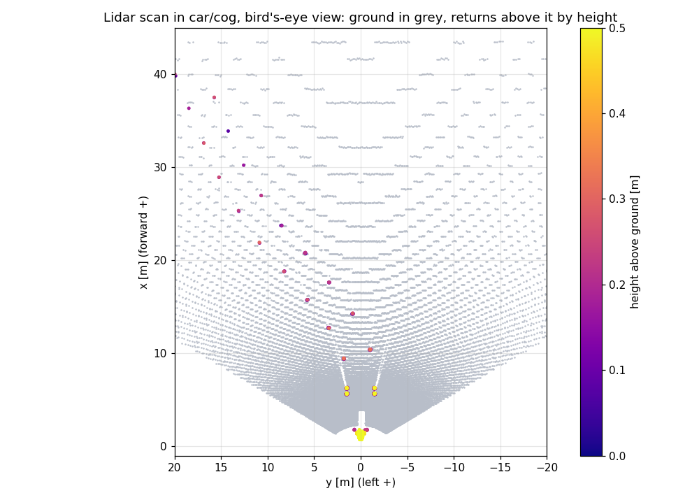
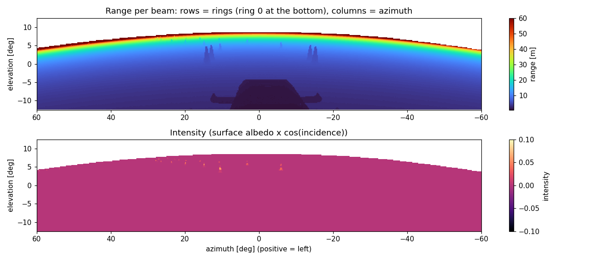
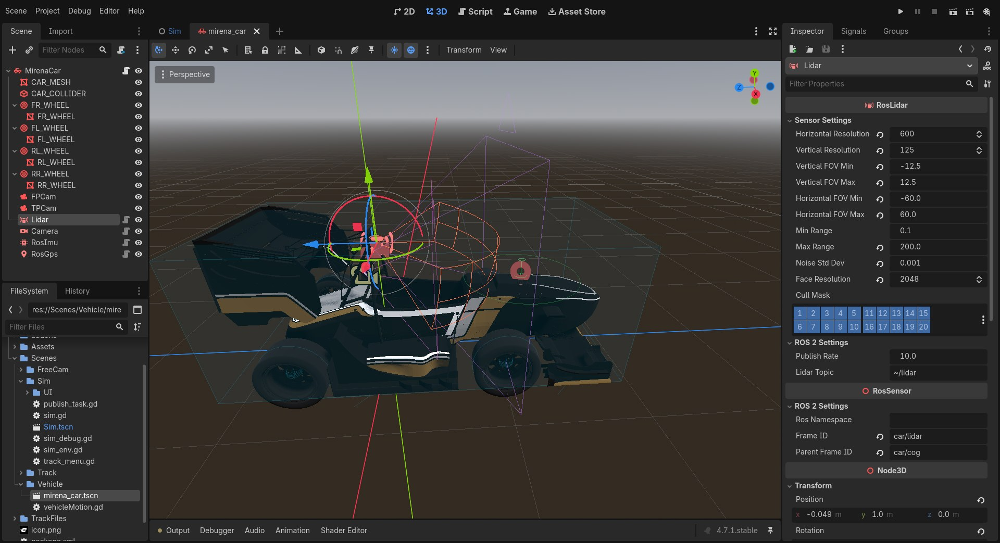
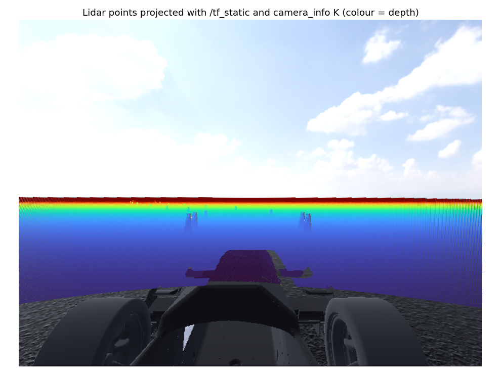

# Lidar

`RosLidar` renderiza la escena en un cubemap y reconstruye una distancia por dirección de medida mediante shaders de cómputo. Publica una nube **organizada**: cada fila corresponde a un haz vertical o `ring` y cada columna a un paso de azimut. El buffer GPU ya tiene el formato de `PointCloud2`, de modo que no necesita convertir los puntos en CPU antes de publicarlos.

La imagen incluida en el repositorio muestra un barrido transformado a `car/cog`. Se distinguen las dos filas de conos y los retornos de la parte delantera del coche.

## Salida ROS 2

| Campo | Valor |
| --- | --- |
| Topic del complemento | `lidar_topic`, inicialmente `~/lidar` |
| Topic en Mirena | `/lidar/lidar` |
| Tipo | `sensor_msgs/msg/PointCloud2` |
| Frame en Mirena | `car/lidar` |
| Dimensiones | `height = vertical_resolution`, `width = horizontal_resolution` |
| Tamaño del punto | `point_step = 20` bytes |
| Tamaño de fila | `row_step = horizontal_resolution × 20` bytes |
| Densidad | `is_dense = false` |
| Sin retorno | `x = y = z = NaN`, `intensity = 0` |

| Campo de cada punto | Tipo | Desplazamiento |
| --- | --- | --- |
| `x` | `float32` | 0 |
| `y` | `float32` | 4 |
| `z` | `float32` | 8 |
| `intensity` | `float32` | 12 |
| `ring` | `uint16` | 16 |
| Relleno | 2 bytes | 18 |

`ring = 0` es el haz más bajo. La primera columna se sitúa en el centro de la primera celda angular, junto al límite `horizontal_fov_min`. Los vecinos en filas y columnas corresponden a haces próximos, lo que permite tratar el barrido como una imagen de distancia o intensidad.

## Modelo de medida

El proceso está implementado en `ros_lidar.gd`, `LidarFaceCapture.glsl` y `LidarStitch.glsl`:

1. Se crean seis cámaras de 90° con planos de recorte `min_range` y `max_range`. En cada captura solo se activan las caras que intersectan el FOV configurado. El lidar de Mirena utiliza las caras frontal y laterales para cubrir 120° × 25°.
2. El compositor de cada cara guarda profundidad e intensidad en una textura `RGBA32F`, con el posprocesado del entorno desactivado.
3. El shader de unión selecciona una cara por haz, consulta su profundidad, reconstruye el punto, comprueba el rango y añade ruido en la dirección del haz.
4. El buffer de puntos se lee de forma asíncrona y se publica conservando la marca de tiempo de la solicitud.

La intensidad aproxima la reflectividad mediante el brillo del color renderizado y el ángulo de incidencia:

$$
I=\frac{R+G+B}{3}\,|\hat n\cdot\hat d|.
$$

La normal $\hat n$ se reconstruye a partir de muestras vecinas de profundidad y $\hat d$ es la dirección del rayo. Es una aproximación lambertiana: una superficie clara y frontal suele dar mayor intensidad que el asfalto oscuro observado con un ángulo rasante.

Las direcciones se distribuyen uniformemente por el FOV, en el centro de cada celda:

$$
\theta=\theta_{\min}+\frac{\mathrm{col}+0.5}{W}(\theta_{\max}-\theta_{\min}),
$$

$$
\varphi=\varphi_{\min}+\frac{\mathrm{ring}+0.5}{H}(\varphi_{\max}-\varphi_{\min}).
$$

En la parametrización del shader, el azimut positivo apunta a la derecha. Después de convertir a ejes ROS, `y` es positivo a la izquierda. El punto final mantiene exactamente la dirección angular de su haz; la resolución de las texturas limita la precisión de su distancia y la localización de los bordes.

### Ruido de distancia

Para un retorno de distancia $r$, el modelo utiliza:

$$
\tilde r=\max(r+\epsilon,r_{\min}),\qquad
\epsilon\sim\mathcal N(0,\sigma^2),
$$

$$
\sigma=\sigma_0\frac{1}{\max(I,0.05)}(1+0.001r^2).
$$

`noise_std_dev` es $\sigma_0$. El ruido aumenta con el cuadrado de la distancia y cuando cae la intensidad. Para $I\leq0.05$, el factor de intensidad multiplica por 20 la desviación base, incluso antes de aplicar el término de distancia. Mirena utiliza una base de 1 mm.

El rango se comprueba **antes** de añadir el ruido; después solo se impone el límite inferior. Un retorno válido próximo a `max_range` puede acabar ligeramente por encima de ese máximo. Cuando `noise_std_dev <= 0.00001`, el shader omite la perturbación.

## Configuración

| Propiedad | Complemento | Mirena | Significado |
| --- | --- | --- | --- |
| `horizontal_resolution` | 1024 | 600 | Columnas por barrido |
| `vertical_resolution` | 64 | 125 | Haces o filas por barrido |
| `horizontal_fov_min` / `horizontal_fov_max` | −180° / 180° | −60° / 60° | Límites de azimut |
| `vertical_fov_min` / `vertical_fov_max` | −45° / 45° | −12.5° / 12.5° | Límites de elevación |
| `min_range` / `max_range` | 0.1 / 100 m | 0.1 / 200 m | Intervalo previo al ruido y planos de recorte |
| `noise_std_dev` | 0.005 m | 0.001 m | Desviación base del ruido |
| `face_resolution` | 256 | 2048 | Píxeles por lado de cada cara |
| `cull_mask` | Todas las capas | Todas las capas | Mallas visibles |
| `publish_rate` | 10 Hz | 10 Hz | Tasa solicitada, limitada por el renderizado |
| `lidar_topic` | `~/lidar` | `~/lidar` | Topic de salida |

El montaje de Mirena inclina el sensor 10° hacia abajo. Las propiedades de namespace y frames se explican en [Sensores](../sensores.md).

### Resolución y coste

Si `face_resolution <= 0`, el script utiliza `nearest_po2(horizontal_resolution / 4)`, limitado al intervalo 64–1024. Cada haz consulta un único texel. Como referencia aproximada, la resolución angular de una cara es del orden de $90°/\mathrm{face\_resolution}$; la relación exacta cambia con la posición dentro de la proyección perspectiva.

Mirena tiene una separación nominal de 0.2° en ambos ejes: 120°/600 y 25°/125. Sus caras de 2048 píxeles ofrecen una resolución espacial más fina que esa rejilla, a costa de mayor trabajo en GPU. El coste de renderizado aumenta con el área de las caras y con el número de caras activas; el tamaño de la nube aumenta con `horizontal_resolution × vertical_resolution`.

## Fusión con cámara

La figura del repositorio proyecta la nube sobre la imagen usando TF y la matriz `K` de `CameraInfo`. Para repetir esa operación, transforma cada punto desde `car/lidar` a `car/camera_optical`, consulta la pose en `header.stamp` y aplica los intrínsecos de la [cámara](camara.md). Las capturas de ambos sensores no están sincronizadas por hardware; usa sus marcas temporales al emparejarlas.

## Límites del modelo

- Todos los haces de un barrido representan la misma captura. No se simula el barrido temporal ni la distorsión de movimiento de un lidar giratorio.
- Solo hay un retorno por haz. No se modelan divergencia del haz, múltiples retornos, lluvia, polvo ni trayectorias múltiples.
- La intensidad procede del color de la escena y una aproximación geométrica; no es una calibración radiométrica de un dispositivo real.
- El sensor observa mallas renderizadas, incluida la carrocería si su capa está dentro de `cull_mask`.
