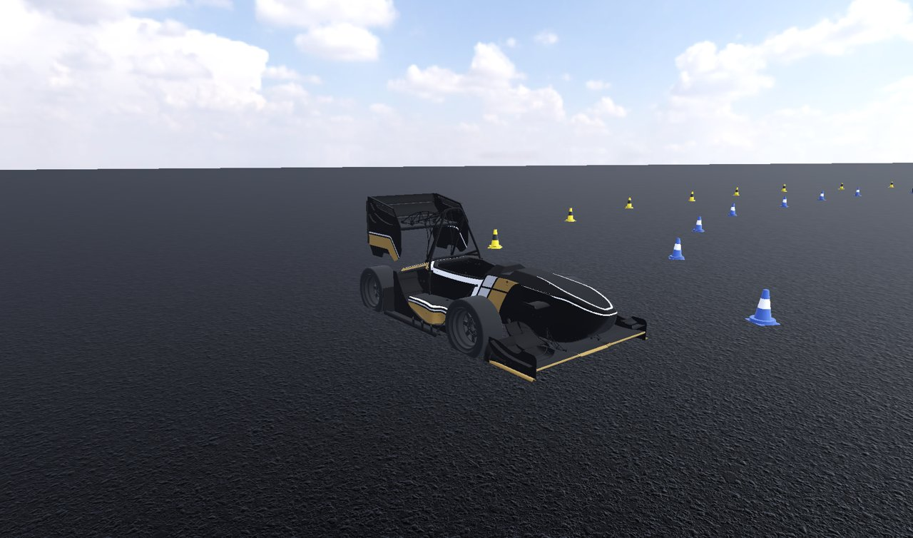
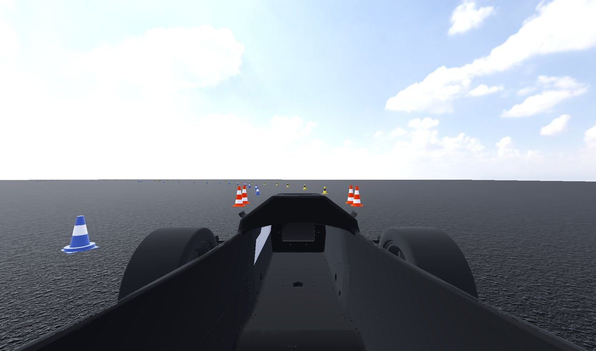
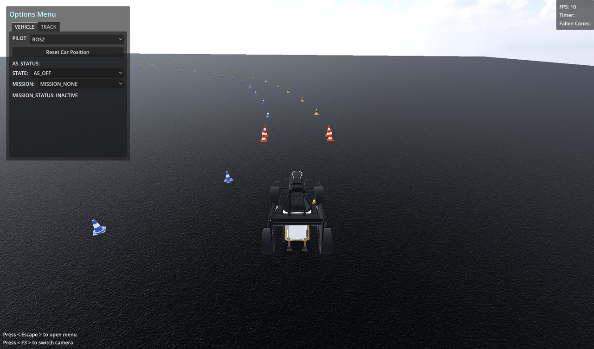
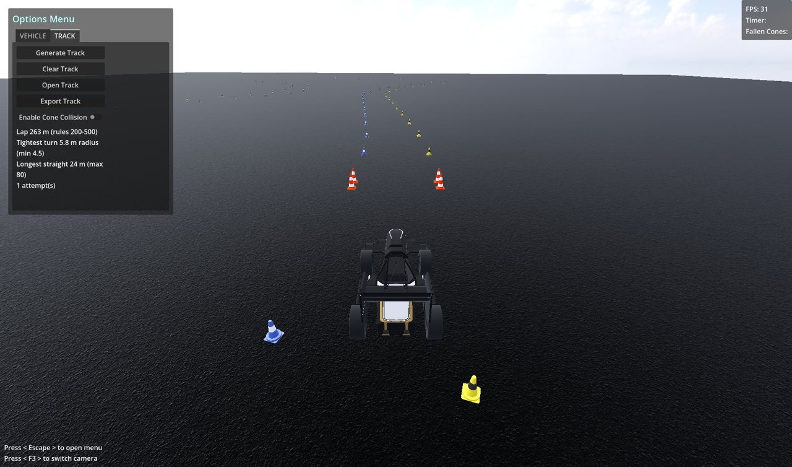
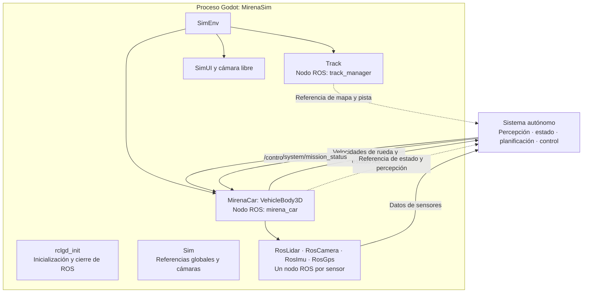
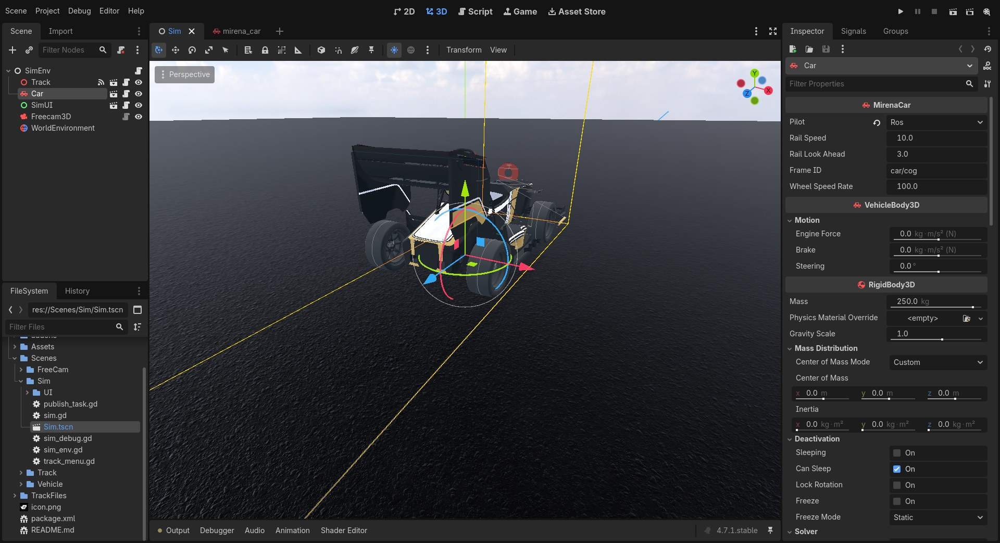
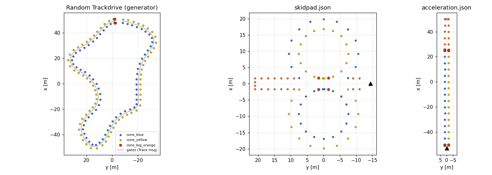
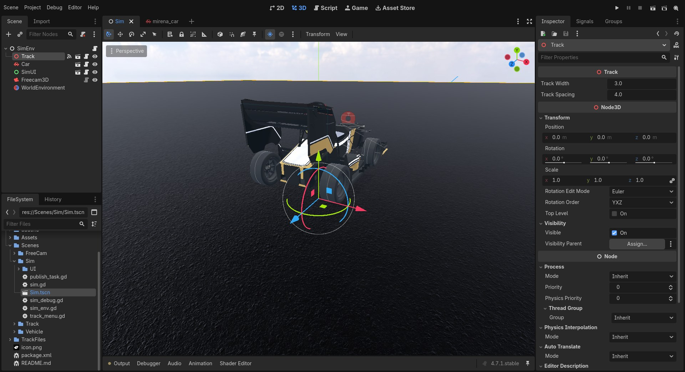

# Simulador



**MirenaSim** es el proyecto Godot 4 de `src/mirena_sim`. Representa un monoplaza de Formula Student sobre un plano de asfalto, con pistas delimitadas por conos, y se comunica con ROS 2 mediante `rclgd`. El proyecto utiliza el renderizador **Forward+** y Vulkan.

El simulador integra la dinámica del vehículo a **400 Hz**, genera imágenes y nubes lidar con la GPU, y proporciona IMU, GNSS y velocidades de rueda. Las interfaces de sensores y control permiten conectar los mismos nodos de percepción, estimación y control que se utilizan en el coche. Las salidas de referencia real, o *ground truth*, permiten evaluar sus resultados.

## Arranque y controles

Con el workspace compilado y su entorno cargado:

```bash
ros2 run mirena_sim mirena_sim --display-driver x11 --ros-args -p track:=random
```

Consulta [Ejecución](ejecucion.md) para preparar el entorno y lanzar el resto del sistema.

| Acción | Teclado | Mando |
| --- | --- | --- |
| Acelerar | `W` | Eje 3 positivo |
| Frenar | `S` | Eje 2 positivo |
| Girar a izquierda / derecha | `A` / `D` | Stick izquierdo |
| Freno de emergencia manual | `Espacio` | — |
| Cambiar cámara | `F3` | — |
| Mostrar u ocultar el menú | `Esc` | — |
| Cámara libre: avanzar / retroceder / desplazarse | `W` / `S` / `A` / `D` | — |
| Cámara libre: subir / bajar | `Espacio` / `Shift` | — |
| Cámara libre: mirar | Ratón | — |
| Cámara libre: ajustar velocidad | Rueda del ratón | — |
| Cámara libre: capturar o liberar el ratón | `Tab` | — |

La conducción con teclado o mando se activa con el piloto **Manual**. La escena principal arranca en modo **ROS**; se puede cambiar desde el menú. Los [modos de piloto](vehiculo.md#modos-de-piloto) determinan de dónde proceden las órdenes. La tabla refleja los ejes de mando guardados en `project.godot`; si tu dispositivo utiliza otra distribución, ajusta las acciones `manual_gas_pos`, `manual_gas_neg` y `manual_steer_*` en **Project Settings → Input Map**.

`F3` recorre las vistas de seguimiento, a bordo y libre. Estas cámaras dibujan la ventana; la cámara que publica imágenes en ROS es otro nodo.



## Menú del simulador

Pulsa `Esc` para abrir las opciones. El panel de estadísticas muestra los fotogramas por segundo, útiles para comprobar si el renderizado mantiene el ritmo de los sensores.

### Pestaña VEHICLE



Permite elegir el piloto, reiniciar el coche con **Reset Car Position** y seleccionar el estado del sistema autónomo y la misión publicados en `/as_status`. El estado de misión que aparece en pantalla corresponde al último mensaje recibido en `/system/mission_status`.

Reiniciar devuelve el coche a la salida de la pista, anula sus velocidades y borra los conos acumulados en el mapa SLAM de referencia. Cargar o generar una pista también reinicia la posición. Si el coche cae por debajo de `y = −1 m` en coordenadas Godot, se reinicia automáticamente.

### Pestaña TRACK



Ofrece estas operaciones:

| Control | Función |
| --- | --- |
| Generar pista | Crea un circuito aleatorio y sitúa el coche en su salida. |
| Limpiar pista | Elimina los conos de la escena. |
| Open Track | Carga una pista desde un archivo JSON. |
| Export Track | Guarda conos, línea central y pose de salida en JSON. |
| Colisiones con conos | Activa el contacto físico entre coche y conos; inicialmente está desactivado. |

Tras generar una pista, el panel indica la longitud de vuelta, el radio mínimo de giro, la recta más larga y los intentos empleados. Si el generador utiliza el circuito circular de reserva, también lo indica.

## Arquitectura

La escena principal es `Scenes/Sim/Sim.tscn`. Godot organiza el entorno, el coche y sus sensores como un árbol de nodos. Cada componente conectado a ROS crea su propio nodo ROS, con sus publicadores, suscripciones y frecuencias.





| Componente | Archivo | Responsabilidad |
| --- | --- | --- |
| `rclgd_init`, autoload | `addons/rclgd/ros_init.gd` | Recoge los argumentos ROS y los ajustes `ros/parameters/*`, inicializa `rclgd` y cierra su contexto al salir. |
| `Sim`, autoload | `Scenes/Sim/sim.gd` | Expone `Sim.car` y `Sim.track`, interpreta argumentos y gestiona las cámaras de visualización. |
| `SimEnv` | `Scenes/Sim/sim_env.gd` | Registra las referencias al coche y la pista antes de que sus hijos terminen de arrancar. |
| `Track` | `Scenes/Track/track.gd` | Carga o genera pistas, coloca los conos y puertas, determina la salida y publica el mapa de referencia. |
| `MirenaCar` | `Scenes/Vehicle/vehicleMotion.gd` | Aplica los modos de piloto, la dirección y la tracción; recibe órdenes y publica el estado del coche. |
| Sensores | `addons/rclgd-sensors/` | Generan medidas y publican los TF estáticos de montaje. |

La configuración física se explica en [Vehículo](vehiculo.md), los modelos de medida en [Sensores](sensores.md) y el contrato de mensajes en [Interfaces ROS 2](topics.md).

### Hilos, frecuencias y tiempo

| Ejecución | Trabajo |
| --- | --- |
| Física, 400 Hz | Integración de `VehicleBody3D`, tracción y frenado, muestreo de IMU y publicación de `/debug/state/car`. |
| Actualización y renderizado | Escena, interfaz, cámaras y pasadas GPU de lidar y profundidad. |
| Ejecutor ROS | Callbacks de suscripciones y temporizadores ROS, cuando `use_separate_thread` está habilitado. |
| Colas de publicación | Un hilo por flujo de sensor GPU copia los datos leídos y publica los mensajes. |

`project.godot` habilita un hilo de física separado y un máximo de **20 pasos físicos por fotograma**. También configura `use_sim_time=false` y `use_separate_thread=true`; los argumentos de línea de comandos pueden sobrescribir esos parámetros.

Los sensores GPU son asíncronos: guardan la marca temporal cuando solicitan la captura, renderizan en el siguiente fotograma y recuperan los datos con varios fotogramas de latencia. La marca se conserva hasta la publicación y corresponde a la solicitud de captura, no al instante de envío. Las colas mantienen hasta tres capturas pendientes; si la publicación se retrasa más, descartan la más antigua.

Con la configuración por defecto, las marcas utilizan el reloj ROS sin tiempo simulado. La cámara y el lidar capturan como máximo una vez por fotograma: aumentar su frecuencia o resolución puede reducir la frecuencia efectiva si la GPU no mantiene el ritmo. La IMU se muestrea en los pasos físicos y publica a su propia frecuencia.

## Coordenadas y árbol TF

Godot utiliza **Y hacia arriba y −Z hacia delante**. Los valores publicados en ROS se expresan con **X hacia delante, Y hacia la izquierda y Z hacia arriba**:

| Eje ROS | Componente Godot |
| --- | --- |
| `x`, delante | `−z` |
| `y`, izquierda | `−x` |
| `z`, arriba | `+y` |

`RosSensor.to_ros()` transforma vectores y `RosSensor.to_ros_quat()` transforma cuaterniones con el mismo cambio de base.

El coche proporciona este subárbol TF:

```text
car/cog
├── car/lidar                  estático
├── car/camera                 estático
│   └── car/camera_optical     estático: z delante, x derecha, y abajo
├── car/imu                    estático
├── car/gps                    estático
└── debug_odom                 dinámico: referencia real
    └── debug_map              estático: origen del mundo Godot
```

El estimador del sistema autónomo proporciona el padre de `car/cog`, normalmente `odom → car/cog`. El simulador sitúa su referencia real bajo el coche para que este marco conserve un único padre. `debug_odom` representa la pose de salida de la pista y `debug_map` el origen del mundo Godot. Sus transformaciones de referencia son planas: `x`, `y` y guiñada; el balanceo y cabeceo del cuerpo no inclinan el mapa.

En RViz, un marco fijo `map` permite comparar el mundo real con el coche estimado. Un marco fijo `debug_map` permite observar cómo deriva la estimación sobre el mundo de referencia. La transformación estática a `debug_map` se vuelve a publicar al cambiar la salida.

Las interfaces para el sistema autónomo y las publicaciones de evaluación están descritas en [Interfaces ROS 2](topics.md). Usa `/debug/*` y `/track_manager/*` como referencia de evaluación; los algoritmos que se quieran trasladar al coche deben consumir los sensores y sus estimaciones.

## Pistas



El simulador incluye pistas de **skidpad** y **aceleración**, y puede generar circuitos Trackdrive. Los conos pertenecen al grupo Godot `Cones` y tienen cuatro tipos:

| Tipo JSON | Uso |
| --- | --- |
| `cone_blue` | Límite izquierdo. |
| `cone_yellow` | Límite derecho. |
| `cone_orange` | Señalización de eventos y líneas. |
| `cone_big_orange` | Salida, llegada y líneas de cronometraje. |

### Cargar, generar y exportar

El parámetro `track` del nodo `track_manager` acepta `random` o una ruta a un JSON. También se puede cambiar durante la ejecución:

```bash
# Cargar al arrancar; sustituye la ruta por la de tu archivo.
ros2 run mirena_sim mirena_sim --display-driver x11 --ros-args -p track:=/ruta/absoluta/skidpad.json

# Generar otra pista con el simulador abierto.
ros2 param set /track_manager track random
```

El botón **Open Track** carga el mismo formato. Cada carga o generación emite `track_loaded`, que devuelve el coche a la nueva salida y limpia su mapa SLAM de referencia.

**Export Track** guarda las coordenadas respecto a la pose de salida del coche, con `car_start_pose` a cero. Este formato sirve también como entrada para pruebas del planificador.

### Formato JSON

Las posiciones están en metros y los ángulos `psi` en radianes, con los ejes ROS. El objeto `setup.car_start_pose` determina la salida. `path` es opcional y contiene la línea central que se publica como pista. Para utilizar esa curva en el modo **Track rail**, consulta la [limitación del cargador y el orden de carga](vehiculo.md#modos-de-piloto).

```json
{
  "metadata": {
    "track_name": "Ejemplo",
    "description": "Pista de ejemplo",
    "date": "2026-01-23"
  },
  "setup": {
    "car_start_pose": {"x": 0.0, "y": -14.4, "psi": 1.57}
  },
  "cones": [
    {"type": "cone_blue", "x": -1.637, "y": 0.2},
    {"type": "cone_yellow", "x": 1.500, "y": 0.2}
  ],
  "path": {
    "closed": false,
    "points": [{"x": 0.0, "y": 0.0}, {"x": 4.0, "y": 0.1}]
  }
}
```

El ejemplo ilustra la estructura del archivo; sus dos puntos no forman un circuito Trackdrive. Para probar el seguimiento de línea central, carga una pista completa que incluya `path`.

### Generación aleatoria

`Scenes/Track/track_generator.gd` genera una propuesta a partir del contorno de una región de ruido Perlin. Aplica cuatro iteraciones de suavizado Chaikin, remuestrea cada **2 m**, abre las curvas mediante hasta **400** rondas de relajación y escala el resultado.

Las medidas finales se toman sobre la curva interpolada que utiliza Godot para colocar las puertas. El código comprueba los siguientes límites, que sus comentarios asocian a reglas de Formula Student:

| Comprobación del generador | Límite configurado |
| --- | --- |
| Radio mínimo de giro | 4,5 m; el ajuste inicial usa un margen de 1,25 veces ese radio. |
| Recta más larga | 80 m. |
| Longitud de vuelta | Entre 200 y 500 m. |
| Separación entre tramos no adyacentes | Al menos 8 m. |
| Ancho de pista | 3 m mediante `Track.track_width`. |
| Distancia entre puertas | 4 m mediante `Track.track_spacing`. |

Estos valores describen la implementación del repositorio. El ancho y la separación de puertas se ajustan en el nodo `Track`; el generador de la línea central no corrige un ancho editado manualmente.

Si una propuesta incumple los límites, se vuelve a generar, hasta **40 intentos**. Si todos fallan, se utiliza una circunferencia de reserva y se indica en la pestaña TRACK. En las pistas generadas, el coche se coloca **6 m antes de la línea de salida**.



`track_width` mide la separación entre el cono azul y el amarillo de cada puerta. `track_spacing` mide la distancia entre puertas a lo largo de la línea central.
