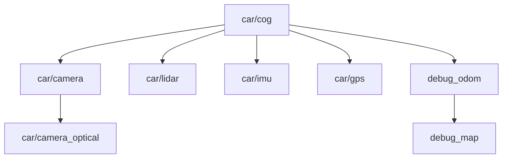

# Interfaces ROS 2

El simulador expone sensores, recibe órdenes de conducción y publica la referencia exacta del mundo para evaluar otros nodos. Esta página describe la escena principal `Scenes/Sim/Sim.tscn` y la configuración de `Scenes/Vehicle/mirena_car.tscn` incluidas en el repositorio.

Las frecuencias son las configuradas en el código, no mediciones de rendimiento. La carga de la GPU, el renderizado y la física pueden reducir la frecuencia observada.

## Nodos e interfaces

Los sensores crean un nodo con su nombre convertido a `snake_case`. En la escena incluida, `ros_namespace` está vacío: `Camera` genera el nodo `/camera`, `Lidar` genera `/lidar`, `RosImu` genera `/ros_imu` y `RosGps` genera `/ros_gps`. Sus topics privados `~/…` se resuelven bajo esos nombres.

### Entradas del vehículo

| Topic | Tipo | Uso |
| --- | --- | --- |
| `/control` | `mirena_common/msg/CarControl` | Aceleración o frenado y ángulo de dirección. Se aplica cuando el piloto es `ROS`. |
| `/system/mission_status` | `mirena_common/msg/MissionInfo` | Estado de misión recibido del sistema externo y mostrado en la interfaz. |

### Sensores publicados

| Topic | Tipo | Frecuencia configurada | `header.frame_id` |
| --- | --- | --- | --- |
| `/lidar/lidar` | `sensor_msgs/msg/PointCloud2` | 10 Hz | `car/lidar` |
| `/camera/image_raw` | `sensor_msgs/msg/Image` | 60 Hz | `car/camera_optical` |
| `/camera/camera_info` | `sensor_msgs/msg/CameraInfo` | 60 Hz, junto a la imagen | `car/camera_optical` |
| `/ros_imu/data` | `sensor_msgs/msg/Imu` | 100 Hz | `car/imu` |
| `/ros_gps/fix` | `sensor_msgs/msg/NavSatFix` | 10 Hz | `car/gps` |
| `/sensors/wheel_speeds` | `mirena_common/msg/WheelSpeeds` | 100 Hz | `car/cog` |

La cámara y el LiDAR capturan como máximo una muestra por fotograma renderizado. La IMU toma muestras en cada tick de física y publica a su propia frecuencia; el proyecto configura la física a 400 Hz. Las velocidades de rueda tienen un temporizador independiente, configurable mediante `wheel_speed_rate`.

La cámara también implementa `/camera/depth/image_raw` y `/camera/depth/camera_info`, con el mismo frame óptico y calibración que el color. Estos topics se crean al activar `publish_depth`, desactivado en la escena por defecto. La imagen de color usa `rgba8`; la profundidad usa `32FC1`, expresa metros a lo largo del eje óptico y utiliza cero para píxeles sin retorno.

### Estado, referencia y circuito

| Topic | Tipo | Frecuencia configurada | Frame / contenido |
| --- | --- | --- | --- |
| `/debug/state/car` | `mirena_common/msg/Car` | Cada tick de física, 400 Hz nominales | Pose en `debug_odom`; velocidades en `car/cog`. |
| `/debug/perception` | `mirena_common/msg/EntityList` | 10 Hz | Conos en el campo visual de la cámara a menos de 12 m, relativos a `car/cog`. |
| `/debug/slam` | `mirena_common/msg/EntityList` | 10 Hz | Conos vistos acumulados, expresados en `debug_map`. |
| `/inferred_control` | `mirena_common/msg/CarControl` | 10 Hz | Valores `gas` y `steering` aplicados por el vehículo; frame `car/cog`. |
| `/as_status` | `mirena_common/msg/AsInfo` | 10 Hz | Estado AS y misión seleccionados en el menú del vehículo. |
| `/track_manager/track` | `mirena_common/msg/Track` | 1 Hz | Puertas del circuito y bandera `is_closed`, en `debug_map`. |
| `/track_manager/full_map` | `mirena_common/msg/EntityList` | 1 Hz | Todos los conos del mundo, en `debug_map`. |

La percepción de depuración usa la posición exacta de los conos y el campo visual de la cámara: sirve de referencia para pruebas. El mapa de `/debug/slam` se vacía al reiniciar el coche. El estado `/debug/state/car` publica una covarianza de 6 × 6 a cero porque procede directamente del simulador.

`Scenes/Sim/sim_debug.gd` conserva otra implementación con topics `/sim/debug/*`, pero la escena principal no instancia ese script. Esos topics no forman parte de la ejecución descrita aquí.

## Enviar órdenes de conducción

`mirena_common/msg/CarControl` contiene:

```text
std_msgs/Header header
float64 gas
float64 steer_angle
```

| Campo | Unidad | Significado |
| --- | --- | --- |
| `gas` | Sin unidad, contrato `[-1, 1]` | `1` es aceleración máxima, `0` elimina la tracción y `-1` es frenado máximo. Un valor negativo frena; no solicita marcha atrás. |
| `steer_angle` | Radianes | Dirección positiva en sentido antihorario. |

Selecciona **ROS** en el piloto del menú del vehículo antes de enviar órdenes. La escena principal ya configura este modo al arrancar. Los modos manual, seguimiento del circuito y sin piloto utilizan su propia lógica, aunque el suscriptor de `/control` siga recibiendo mensajes.

Con el entorno ROS y el workspace cargados, puedes enviar una orden suave y recta:

```bash
ros2 topic pub --rate 20 /control mirena_common/msg/CarControl \
  '{gas: 0.1, steer_angle: 0.0}'
```

Para frenar, sustituye la orden anterior por:

```bash
ros2 topic pub --rate 20 /control mirena_common/msg/CarControl \
  '{gas: -1.0, steer_angle: 0.0}'
```

El vehículo conserva el último `gas` y `steer_angle` recibidos: detener `ros2 topic pub` no envía una orden de parada. El código aplica directamente esos dos campos, sin comprobar la antigüedad de `header.stamp` ni limitar sus valores al rango del contrato. El límite de 30° definido en el script se usa en conducción manual; el emisor ROS debe proporcionar un ángulo adecuado.

El modo `ROS` aplica `/control` con independencia del estado AS y de `/system/mission_status`. El estado de misión se guarda para mostrarlo en la interfaz. La lógica que habilita o bloquea la conducción por misión corresponde al sistema externo que envía el control.

## Mensajes propios

Las definiciones completas están en [`src/mirena_common/msg`](https://github.com/RobeSafe-UAH/mirena_ws/tree/main/src/mirena_common/msg).

| Mensaje | Campos principales | Finalidad |
| --- | --- | --- |
| `Car` | `header`, `x`, `y`, `psi`, `child_frame_id`, `u`, `v`, `omega`, `covariance[36]` | Estado plano y covarianza de `[x, y, psi, u, v, omega]`, almacenada por filas. |
| `CarControl` | `header`, `gas`, `steer_angle` | Orden o referencia de actuación. |
| `WheelSpeeds` | `header`, `fl`, `fr`, `rl`, `rr` | Velocidades de rueda. El simulador rellena `rl` y `rr` con RPM de las ruedas traseras, con signo corregido; `fl` y `fr` quedan a cero. |
| `Entity` | `position`, `type`, `confidence` | Entidad estática. Los publicadores de referencia rellenan posición y tipo; no calculan una confianza. |
| `EntityList` | `header`, `entities[]` | Conjunto de conos en un frame común. |
| `Gate` | `x`, `y`, `psi` | Pose plana de una puerta del circuito. |
| `Track` | `header`, `gates[]`, `is_closed` | Representación del trazado. |
| `AsInfo` | `status`, `mission` | Estado del sistema autónomo y prueba seleccionada. |
| `MissionInfo` | `status`, `cones_count_actual`, `cones_count_total`, `lap_counter` | Estado y contadores de misión del sistema externo. |
| `Heartbeat` | `timestamp`, `node_name`, `report` | Interfaz disponible para informes; la escena principal no publica un heartbeat. |

Los tipos de cono son `cone_blue`, `cone_yellow`, `cone_orange` y `cone_big_orange`.

### Estados AS y misión

| `AsInfo.status` | Valor |
| --- | --- |
| `AS_STATUS_OFF` | 1 |
| `AS_STATUS_READY` | 2 |
| `AS_STATUS_DRIVING` | 3 |
| `AS_STATUS_EMERGENCY` | 4 |
| `AS_STATUS_FINISHED` | 5 |

El script inicializa `AsInfo.status` a `0` antes de que el usuario elija un estado; ese valor no tiene una constante `AS_STATUS_*` en el mensaje.

| `AsInfo.mission` | Valor |
| --- | --- |
| `AS_MISSION_NONE` | 0 |
| `AS_MISSION_ACCELERATION` | 1 |
| `AS_MISSION_SKIDPAD` | 2 |
| `AS_MISSION_TRACKDRIVE` | 3 |
| `AS_MISSION_BRAKE_TEST` | 4 |
| `AS_MISSION_INSPECTION` | 5 |
| `AS_MISSION_AUTOCROSS` | 6 |

`MissionInfo.status` usa otra enumeración: `INACTIVE=0`, `CONFIGURING=1`, `READY=2`, `RUNNING=3`, `FINISHED=4` y `FAILED=5`. No intercambies estos valores con los de `AsInfo.status`.

## Frames y ejes

Las posiciones y velocidades cambian de ejes al salir de Godot:

| Eje ROS | Eje Godot | Interpretación en el vehículo |
| --- | --- | --- |
| `+X` | `−Z` | Hacia delante. |
| `+Y` | `−X` | Hacia la izquierda. |
| `+Z` | `+Y` | Hacia arriba. |

La conversión de un vector es `(x_ros, y_ros, z_ros) = (−z_godot, −x_godot, y_godot)`. En `Car`, `x` e `y` están en metros, `psi` en radianes, `u` y `v` en m/s y `omega` en rad/s. En la cámara, el frame óptico usa `+Z` hacia delante, `+X` a la derecha y `+Y` hacia abajo.

El simulador publica este subárbol TF:



Las transformaciones de montaje de los sensores y `car/camera → car/camera_optical` son estáticas. `car/cog → debug_odom` es la inversa de la pose de referencia del coche y se actualiza en cada tick de física. `debug_odom → debug_map` representa la inversa de la pose de inicio; se vuelve a publicar cuando cambia el origen.

`debug_map` corresponde al mundo Godot y `debug_odom` a la pose inicial del vehículo. Las transformaciones de referencia son planas para evitar que el balanceo o cabeceo del coche inclinen el mundo en RViz.

Al integrarlo con la estimación, el nodo externo `mirena_state` es quien debe publicar `/state/car` y la transformación `odom → car/cog`. Este workspace no incluye ese paquete. Mantener la referencia bajo `car/cog` permite comparar la estimación y el mundo simulado sin dar dos padres a ese frame.

## QoS y comprobaciones

Los sensores y `/sensors/wheel_speeds` publican con **best effort**, **keep last**, profundidad **5** y durabilidad **volatile**. Usa la misma fiabilidad al suscribirte; un suscriptor `reliable` no es compatible con estos publicadores. Los publicadores de depuración, circuito y estado AS utilizan el QoS predeterminado de `rclgd`.

Comprueba los nodos y el contrato que anuncia una ejecución:

```bash
ros2 node list
ros2 topic list -t
ros2 topic info --verbose /ros_imu/data
ros2 interface show mirena_common/msg/CarControl
```

Consulta una muestra de cada sensor sin volcar una imagen completa:

```bash
ros2 topic echo /ros_imu/data --once --qos-reliability best_effort
ros2 topic echo /ros_gps/fix --once --qos-reliability best_effort
ros2 topic echo /sensors/wheel_speeds --once --qos-reliability best_effort
ros2 topic echo /camera/camera_info --once --qos-reliability best_effort
```

Inspecciona el estado de referencia, los frames y la pista activa:

```bash
ros2 topic echo /debug/state/car --once
ros2 run tf2_ros tf2_echo debug_map car/cog
ros2 param get /track_manager track
```

Los nodos deben compartir `ROS_DOMAIN_ID`; el flujo Docker usa `42` por defecto. El proyecto configura `use_sim_time=false` y esta escena no implementa un publicador `/clock`.

Para configurar y observar cada dispositivo, continúa en [Sensores](sensores.md). Las instrucciones para lanzar el simulador y RViz están en [Ejecución](ejecucion.md).
