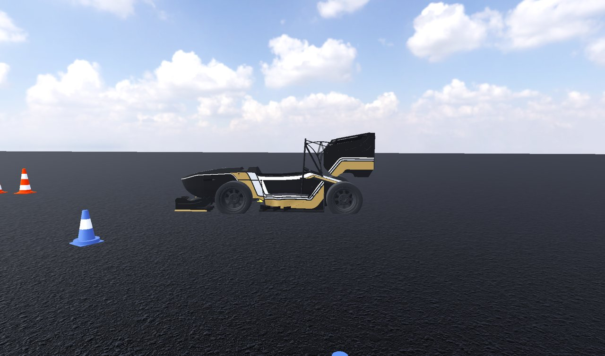
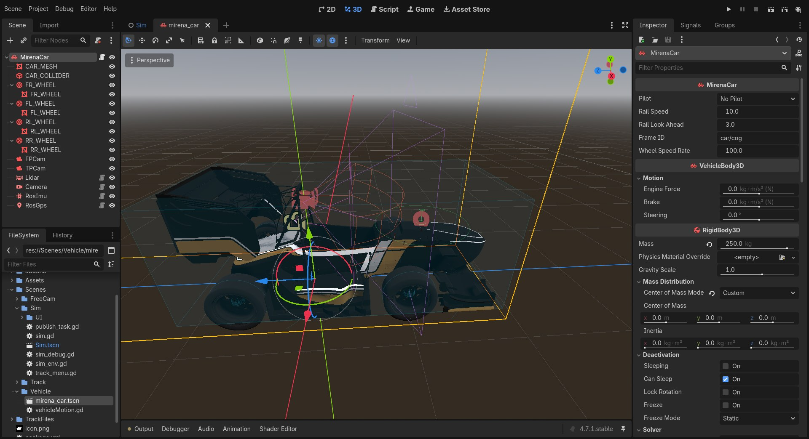
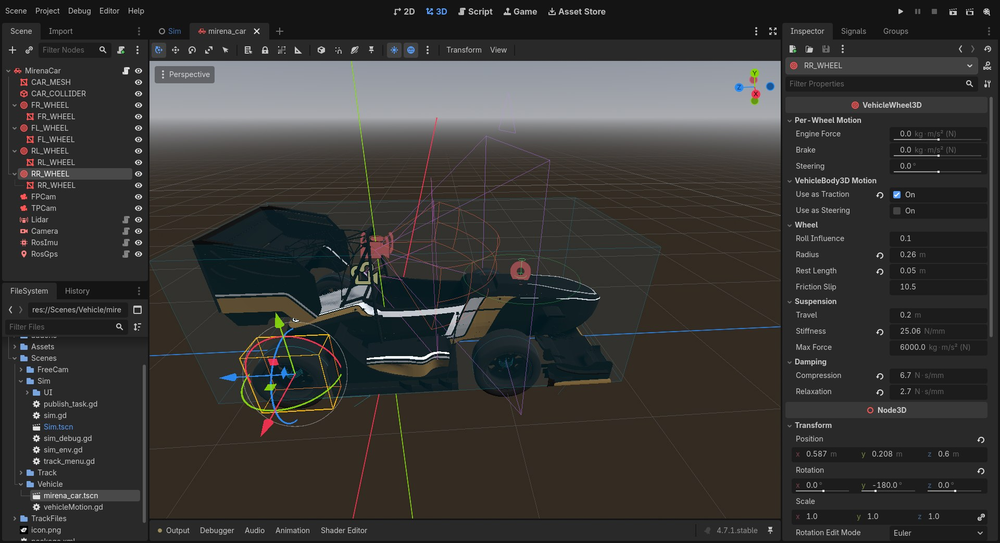
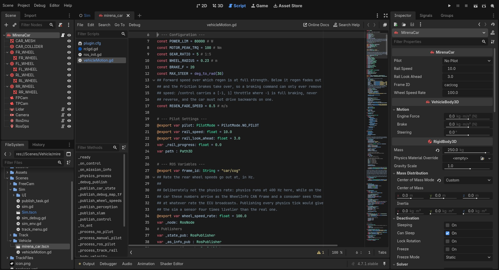
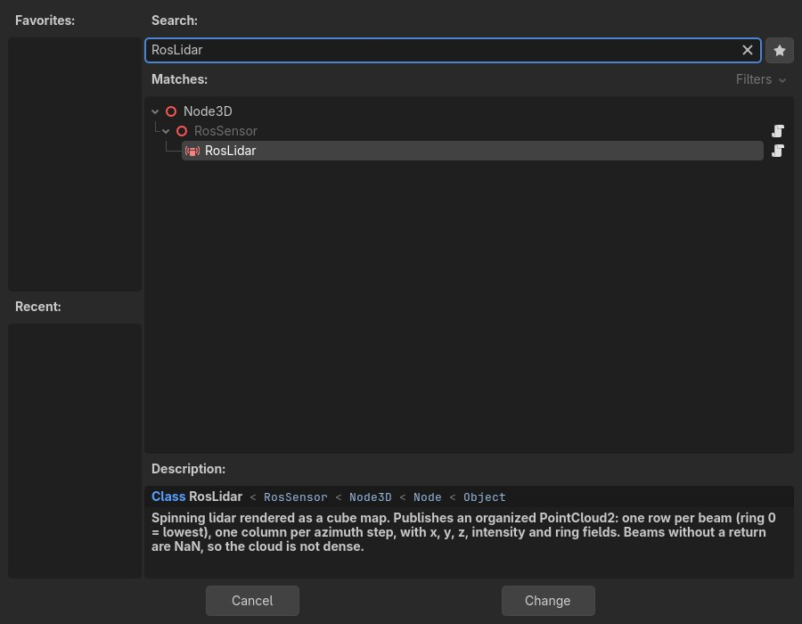

# Vehículo



El vehículo se define en `src/mirena_sim/Scenes/Vehicle/mirena_car.tscn`. Su raíz es un `VehicleBody3D` con el script `Scenes/Vehicle/vehicleMotion.gd`, que registra la clase `MirenaCar`. La escena contiene la carrocería, la colisión, cuatro ruedas, las cámaras de visualización y los sensores ROS.

Para abrirla en el editor desde la raíz del workspace, con el entorno ROS cargado:

```bash
ros2 run rclgd godot --editor --path src/mirena_sim --display-driver x11
```

Después abre `res://Scenes/Vehicle/mirena_car.tscn` desde el panel **FileSystem**.



## Estructura de la escena

```text
MirenaCar             VehicleBody3D: 250 kg, script vehicleMotion.gd
├── CAR_MESH          MeshInstance3D: carrocería visual
├── CAR_COLLIDER      CollisionShape3D: caja del chasis
├── FL_WHEEL          VehicleWheel3D: delantera izquierda, dirección
├── FR_WHEEL          VehicleWheel3D: delantera derecha, dirección
├── RL_WHEEL          VehicleWheel3D: trasera izquierda, tracción
├── RR_WHEEL          VehicleWheel3D: trasera derecha, tracción
├── FPCam             Camera3D: vista a bordo
├── TPCam             Camera3D: seguimiento
├── Lidar             RosLidar: car/lidar
├── Camera            RosCamera: car/camera
├── RosImu            RosImu: car/imu
└── RosGps            RosGps: car/gps
```

El origen del nodo raíz es la referencia `car/cog`, definida por `MirenaCar.frame_id`. Los sensores utilizan `car/cog` como `parent_frame_id`. El centro de masas físico se configura por separado con `center_of_mass_mode = custom` en el inspector.

La caja de colisión mide aproximadamente **1,44 m de ancho, 3,02 m de largo y 1,12 m de alto** una vez aplicada su rotación. La malla visual de la carrocería se encuentra en `Assets/Models/Car/TeR.res`.

## Modelo físico

### Chasis, ruedas y suspensión

`VehicleBody3D` utiliza ruedas de tipo *raycast*: cada `VehicleWheel3D` busca el suelo mediante un rayo, calcula la fuerza de suspensión y aplica las fuerzas de contacto. La integración física se configura a **400 Hz** en `project.godot`.

Las cuatro ruedas comparten estos valores guardados en la escena:

| Propiedad | Valor | Función |
| --- | --- | --- |
| `wheel_radius` | 0,26 m | Radio de rodadura del modelo físico. |
| `wheel_rest_length` | 0,05 m | Longitud de reposo de la suspensión. |
| `suspension_stiffness` | 25,06 | Rigidez de suspensión en la parametrización de Godot. |
| `damping_compression` | 6,7 | Amortiguación en compresión. |
| `damping_relaxation` | 2,7 | Amortiguación en extensión. |
| Vía | 1,174 m | Separación entre las ruedas izquierda y derecha: `x = ±0,587 m`. |
| Batalla | 1,593 m | Distancia entre ejes: delantero `z = −0,993 m`, trasero `z = 0,6 m`. |

`wheel_friction_slip` y `wheel_roll_influence` quedan con los valores por defecto del motor: **10,5** y **0,1**, respectivamente, según la [referencia de VehicleWheel3D](https://docs.godotengine.org/en/stable/classes/class_vehiclewheel3d.html). Además, **RL_WHEEL** tiene una sobrescritura `suspension_max_force = 1000`, que no aparece en las otras tres ruedas. Conviene revisar esa diferencia al ajustar el reparto de cargas.



Las ruedas delanteras tienen `use_as_steering = true`. Las traseras tienen `use_as_traction = true` y reciben la fuerza del motor calculada por el script.

### Tracción y frenado

La función `_apply_vehicle_physics()` utiliza las siguientes constantes:

| Constante | Valor | Uso |
| --- | --- | --- |
| `MOTOR_PEAK_TRQ` | 100 N·m | Par máximo de motor. |
| `GEAR_RATIO` | 5 | Reducción entre motor y rueda. |
| `WHEEL_RADIUS` | 0,23 m | Conversión de par a fuerza en el script. |
| `POWER_LIM` | 80 000 W | Constante declarada; el cálculo actual no aplica este límite. |
| `BRAKE_F` | 20 | Valor del freno manual y límite del freno trasero calculado. |
| `REGEN_FADE_SPEED` | 0,5 m/s | Umbral por debajo del que disminuye la frenada regenerativa. |
| `MAX_STEER` | 30° | Giro máximo en modo Manual. |

La fuerza longitudinal máxima calculada es:

$$
F_{x,\max} = \frac{T_{\mathrm{peak}}\,i}{r}
= \frac{100\cdot 5}{0{,}23}
\approx 2174\ \mathrm{N}.
$$

Para la orden de acelerador `g = gas` y la velocidad longitudinal del cuerpo `u`:

$$
s_{\mathrm{regen}} = \operatorname{clamp}\left(\frac{u}{0{,}5\ \mathrm{m/s}},0,1\right),
$$

$$
F_x = \left(\max(g,0)-\max(-g,0)\,s_{\mathrm{regen}}\right)F_{x,\max}.
$$

La fuerza se reparte por igual entre `RL_WHEEL` y `RR_WHEEL`. Por encima de **0,5 m/s**, una orden negativa utiliza toda la regeneración disponible. Al reducirse la velocidad, el script disminuye esa fuerza y aumenta el valor de freno asignado a las ruedas traseras; en reposo aplica el freno de fricción.

El freno de emergencia manual y el modo **No pilot** asignan `VehicleBody3D.brake`, que se propaga a todas las ruedas en el [código del motor Godot](https://github.com/godotengine/godot/blob/master/scene/3d/physics/vehicle_body_3d.cpp). El frenado adicional que calcula `_apply_vehicle_physics()` con `gas < 0` se asigna explícitamente a las dos ruedas traseras.

En el contrato ROS, `gas ∈ [−1, 1]`: `1` es aceleración completa y `−1` es frenada completa. **Un valor negativo ordena frenar, no circular marcha atrás.** El script utiliza directamente el valor recibido; el controlador debe respetar ese intervalo.

Hay dos radios configurados: **0,26 m en las ruedas físicas** y **0,23 m en la conversión de par a fuerza**. Si cambias el tamaño de rueda, revisa ambos valores para que la relación entre par, fuerza y velocidad represente el vehículo que quieres simular.

### Dirección

En modo ROS, `steer_angle` se copia directamente a `VehicleBody3D.steering`: se expresa en **radianes** y un valor positivo gira a la izquierda. Las dos ruedas delanteras reciben el mismo ángulo. El modelo no incorpora corrección Ackermann, saturación del ángulo ROS ni dinámica del actuador.

En modo Manual, la entrada se suaviza mediante una función `smoothstep` y una tasa configurada de `2/s`, y se escala con `MAX_STEER = 30°`. Si necesitas modelar límites físicos o retardos para un controlador, el punto de extensión es `_process_ros_pilot()`.

## Modos de piloto

`MirenaCar.pilot` selecciona el origen de las órdenes. Se cambia desde la pestaña **VEHICLE** o desde el inspector. La clase tiene `NO_PILOT` como valor inicial, pero `Scenes/Sim/Sim.tscn` lo sobrescribe a **ROS**, que es el modo utilizado al arrancar el simulador normal.

| Modo | Comportamiento |
| --- | --- |
| `NO_PILOT` | Acelerador y dirección a cero; frenos aplicados. |
| `MANUAL` | Teclado o mando. `Espacio` activa el freno de emergencia. |
| `ROS` | Utiliza el último mensaje de `/control`; el controlador ordena la frenada mediante `gas < 0`. |
| `TRACK_RAIL` | Sigue cinemáticamente la línea central a `rail_speed`, mirando hacia un punto situado `rail_look_ahead` por delante. |

En **ROS**, la última orden persiste hasta recibir otra: no hay un temporizador que anule el mando si deja de llegar. Publica las órdenes periódicamente y envía una frenada explícita al finalizar la prueba.

**Track rail**, mostrado como **FollowTrack** en el selector, utiliza `rail_speed = 10 m/s` y `rail_look_ahead = 3 m` por defecto. La selección desde el menú asigna el `TrackPath` de la pista al coche. El modo evita el cálculo de fuerzas de tracción del script y desplaza el cuerpo sobre la trayectoria; resulta útil para repetir pruebas de percepción y SLAM. Sus velocidades dinámicas e IMU no representan una conducción física normal.

En la implementación actual, generar una pista enlaza su curva con `TrackPath`, pero cargar un JSON al arrancar no realiza ese enlace. Para usar **FollowTrack** con una pista JSON, genera primero una pista aleatoria, carga después el archivo con línea central y selecciona **FollowTrack**. Este orden permite que el cargador modifique la curva que ya está enlazada. Un JSON sin `path` tampoco borra una línea central anterior.

### Ejemplo de control ROS

Este nodo publica a **50 Hz** una aceleración del 20 % y una dirección de `0,15 rad` hacia la izquierda:

```python
import rclpy
from rclpy.node import Node
from mirena_common.msg import CarControl


class Driver(Node):
    def __init__(self):
        super().__init__('driver')
        self.publisher = self.create_publisher(CarControl, '/control', 10)
        self.create_timer(0.02, self.tick)

    def tick(self):
        message = CarControl()
        message.header.stamp = self.get_clock().now().to_msg()
        message.header.frame_id = 'car/cog'
        message.gas = 0.2
        message.steer_angle = 0.15
        self.publisher.publish(message)


def main():
    rclpy.init()
    driver = Driver()
    try:
        rclpy.spin(driver)
    except KeyboardInterrupt:
        pass
    finally:
        driver.destroy_node()
        rclpy.shutdown()


if __name__ == '__main__':
    main()
```

Al detener este ejemplo, cambia a **No pilot** desde el menú o sustituye su orden por una frenada. El cierre del nodo por sí solo no elimina el último mando recibido en el simulador.

## Interfaz ROS del coche

`MirenaCar` crea el nodo ROS `mirena_car` y utiliza nombres absolutos:

| Interfaz | Dirección | Contenido |
| --- | --- | --- |
| `/control` | Suscripción | `mirena_common/msg/CarControl`, aplicado en modo ROS. |
| `/system/mission_status` | Suscripción | `mirena_common/msg/MissionInfo`, mostrado en el menú. |
| `/sensors/wheel_speeds` | Publicación, 100 Hz | RPM de las ruedas traseras, con QoS *best effort*. |
| `/as_status` | Publicación, 10 Hz | Estado AS y misión seleccionados en la interfaz. |
| `/debug/state/car` | Publicación, 400 Hz | Estado real del coche y covarianza cero. |
| `/debug/perception`, `/debug/slam` | Publicación, 10 Hz | Conos visibles y conos observados acumulados. |
| `/inferred_control` | Publicación, 10 Hz | Acelerador y dirección aplicados. |
| `car/cog → debug_odom → debug_map` | TF | Transformaciones de referencia real. |

Las velocidades se obtienen con `−get_rpm()` para mantener el signo de avance ROS. Solo se rellenan `rl` y `rr`; `fl` y `fr` permanecen a cero. `wheel_speed_rate` permite modificar los **100 Hz** de publicación sin cambiar la frecuencia física. Así se reproduce una interfaz de medida con frecuencia independiente, como sucede con los mensajes CAN del coche.

`/debug/state/car` expresa la pose `x`, `y`, `psi` respecto a `debug_odom` y las velocidades `u`, `v`, `omega` en el cuerpo del coche. La descripción de campos, marcos y QoS se encuentra en [Interfaces ROS 2](topics.md).

## Personalizar el vehículo

### Parámetros físicos

Selecciona la raíz **MirenaCar** para editar la masa y el centro de masas personalizado. Modificar su altura o su posición longitudinal cambia la transferencia de cargas y el comportamiento del chasis.

Selecciona cada nodo `*_WHEEL` para ajustar las propiedades **Suspension** y **Wheel**. Revisa la simetría izquierda/derecha y las diferencias guardadas en la escena. Las posiciones de montaje determinan la vía y la batalla; `wheel_radius` determina el radio de la rueda física.

Las constantes de transmisión y frenado están al principio de `vehicleMotion.gd`:



Para incorporar tracción a las cuatro ruedas, activa `use_as_traction` en todas ellas y adapta `_apply_vehicle_physics()` para repartir la fuerza entre las cuatro. Activar la propiedad por sí sola no modifica la asignación explícita de fuerza a las dos ruedas traseras.

### Carrocería y cámaras

Sustituye la malla de **CAR_MESH** por tu modelo y ajusta **CAR_COLLIDER** para cubrir su volumen. Los sensores de cámara y lidar observan la geometría renderizada; las colisiones físicas utilizan la forma de colisión.

Las cámaras **FPCam** y **TPCam** se pueden desplazar sin cambiar la salida de los sensores ROS. `FPCam` excluye la capa de renderizado 20 mediante `cull_mask`, lo que permite ocultar partes de la carrocería en la vista a bordo. Cada sensor tiene su propia máscara para controlar qué objetos observa.

### Añadir o mover sensores

Los sensores son nodos Godot normales. Para añadir uno:

1. Selecciona **MirenaCar** y utiliza **Add Child Node** (`Ctrl+A`). Busca `RosLidar`, `RosCamera`, `RosImu` o `RosGps` bajo `Node3D → RosSensor`.
2. Ajusta su posición y orientación en la vista 3D. El complemento `rclgd-sensors` muestra el campo de visión, el volumen de barrido o los ejes y el modelo de error según el tipo de sensor.
3. En **ROS 2 Settings**, configura `frame_id`, `parent_frame_id = car/cog`, el espacio de nombres opcional `ros_namespace` y `publish_rate`.
4. Ajusta el modelo en **Sensor Settings**, siguiendo [Sensores](sensores.md).



Si `frame_id` queda vacío, se utiliza el nombre del nodo convertido a `snake_case`. El nombre también determina el nodo ROS y sus topics privados: un `RosLidar` llamado `LidarFront` publica en `/lidar_front/lidar` si no tiene espacio de nombres. `parent_frame_id = ~base_link`, el valor genérico por defecto, se resuelve respecto al espacio de nombres; en esta escena se sobrescribe con `car/cog`.

El TF de montaje se publica en `/tf_static` al arrancar el sensor, suponiendo una unión rígida. Si mueves un sensor durante la ejecución, ese cambio no actualiza automáticamente su TF; reinicia la escena tras modificar el montaje.

### Sensores de la escena por defecto

Las posiciones de esta tabla están en ejes ROS, respecto a `car/cog`:

| Nodo | Montaje | Configuración |
| --- | --- | --- |
| `Lidar` | `x = 0`, `y = +0,049`, `z = 1,0 m`; inclinado 10° hacia abajo. | 600 × 125 haces; FOV 120° × 25°; alcance 0,1–200 m; 10 Hz; ruido de distancia σ = 1 mm; `face_resolution = 2048`. |
| `Camera` | `x = 0`, `y = −0,068`, `z = 0,98 m`. | 640 × 480 píxeles; FOV vertical 75°; 60 Hz; profundidad desactivada. |
| `RosImu` | `x = 0`, `y = 0`, `z ≈ 0,149 m`. | 100 Hz; parámetros de ruido por defecto de `RosImu`. |
| `RosGps` | `x ≈ 1,208`, `y = 0`, `z ≈ 0,684 m`. | 10 Hz; desviación horizontal 0,5 m y de altitud 1,2 m; marco `car/gps`. |

Las diferencias entre los valores genéricos de las clases de sensor y las sobrescrituras de `mirena_car.tscn` se detallan en [Sensores](sensores.md).
